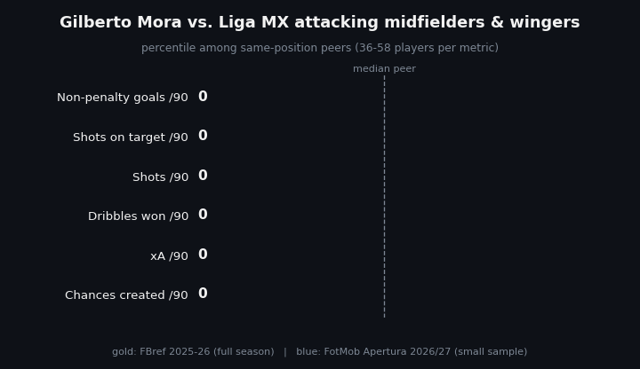
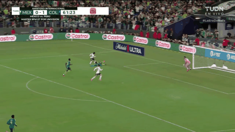
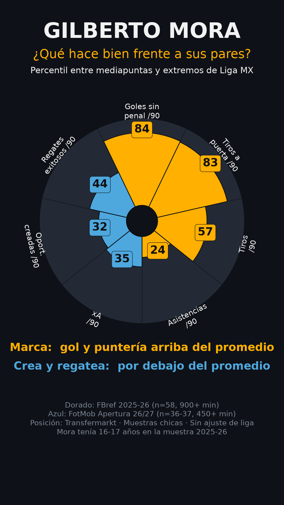
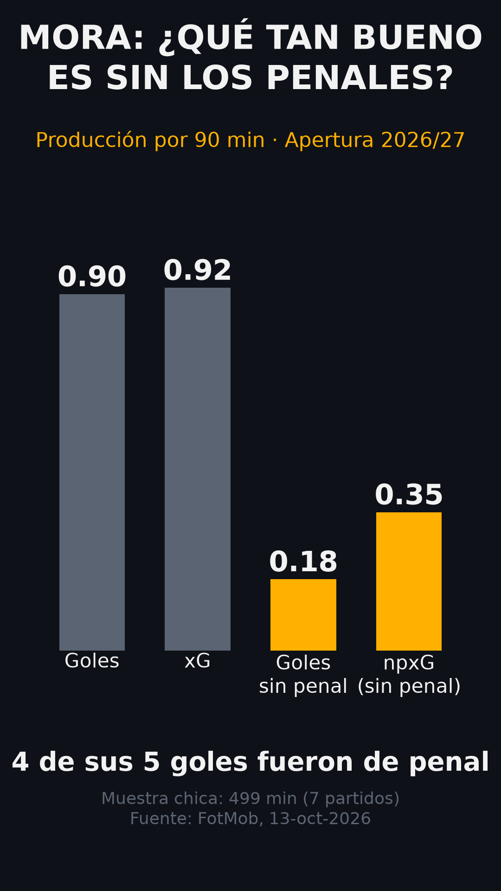
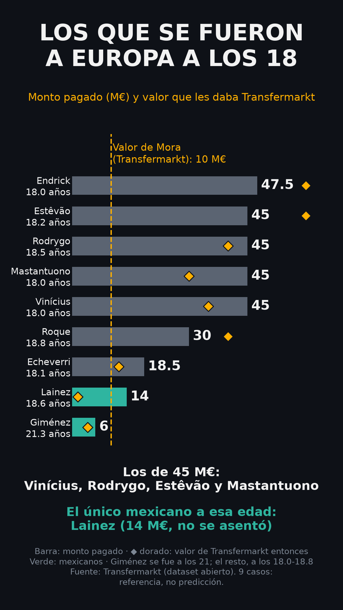
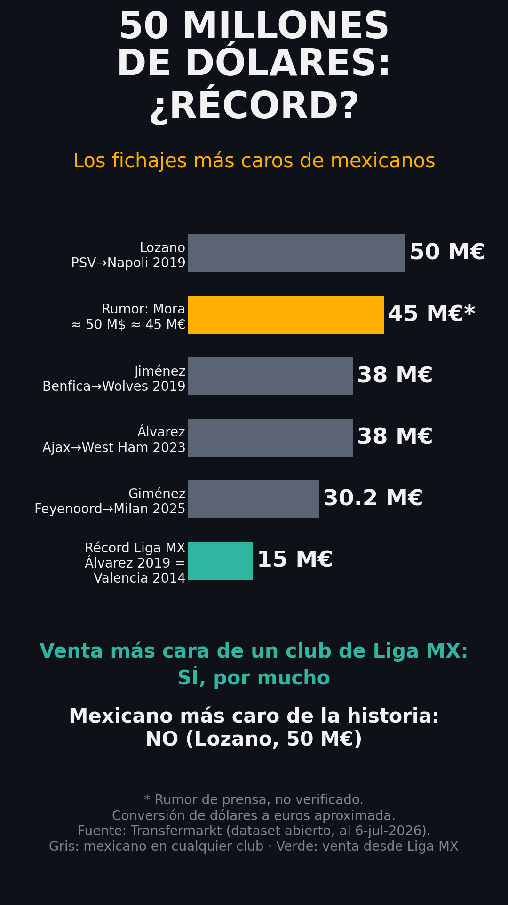

<p align="center">
  
</p>

<p align="center">
  
  
  
  
  
</p>

<p align="center">
  <a href="#what-the-data-says">Findings</a> ·
  <a href="#method">Method</a> ·
  <a href="#data-and-licensing">Data</a> ·
  <a href="#limitations">Limitations</a> ·
  <a href="#what-i-would-do-next">Next steps</a> ·
  <a href="notebooks/mora_analisis.ipynb">Notebook</a>
</p>

Gilberto Mora (Tijuana, born 14 Oct 2008) turned 18 in October 2026, and the press reported that a European club could pay around **US$50M (~€45M)** for him. This project asks a narrow, checkable question:

> **Using public data, who is Mora today compared with players in his position, what happened to players who made the jump to Europe at his age, and how unusual would that price be?**

> [!NOTE]
> This is a statistical exercise, not an opinion on anyone's talent. It does **not** predict whether Mora will move, model his market value, or estimate how he would perform in Europe. The press figure is an unverified rumor and is treated as one.

<table>
  <tr>
    <td width="60%"></td>
    <td width="40%" align="center">
      <br>
      <sub>Mexico vs. Colombia (friendly), TUDN broadcast. Clip shown for illustration only; all rights belong to the broadcaster and it will be removed on request.</sub>
    </td>
  </tr>
</table>

## What the data says

| # | Finding | Evidence | Confidence |
|---|---|---|---|
| 1 | Mora scores and shoots more than he creates | Non-penalty goals/90 **p84**, shots on target/90 **p83** (58 peers, FBref 2025-26); xA/90 p35, chances created p32, dribbles p44 (36-37 peers, FotMob Apertura 2026/27) | 🟡 Medium: small samples, two seasons |
| 2 | His current-tournament goals lean on penalties | 4 of 5 goals are penalties; npxG 0.35/90 in 499 min (7 matches). In 2025-26: 0 penalty goals in 1,131 min | 🟢 High for the data, 🔴 low for projecting it |
| 3 | ~€45M would be the most expensive sale by a Liga MX club | Current record: €15M, shared by Álvarez (2019) and Valencia (2014) | 🟢 High |
| 4 | It would not be the most expensive Mexican transfer | Lozano: €50M (2019) | 🟢 High |
| 5 | The price would be unusual relative to his Transfermarkt value | 8 of 9 comparable jumps fell between 0.75x and 1.54x market value (the exception: 9.3x); Mora would be ~4.5x | 🟡 Medium (n = 9) |
| - | Probability that he moves | Not computable with these data | - |

"Inflated" would be a reading of these numbers, not a fact: a club can pay for projection, which this analysis does not measure.

<table>
  <tr>
    <td align="center" width="25%"><br><sub><b>Profile vs. peers</b><br>percentile pizza</sub></td>
    <td align="center" width="25%"><br><sub><b>The penalty effect</b><br>xG with and without penalties</sub></td>
    <td align="center" width="25%"><br><sub><b>Precedents at 18</b><br>fee vs. market value</sub></td>
    <td align="center" width="25%"><br><sub><b>Records</b><br>Liga MX sales and Mexican transfers</sub></td>
  </tr>
</table>

## Method

1. **Merge** eight hand-copied FotMob tables into one row per player (451 players), plus FBref season tables and the open Transfermarkt dataset.
2. **Validate the manual transcription.** FotMob publishes totals and per-90 values separately, so `total / (minutes / 90)` must match the published per-90 figure. It matches for 290/290 players (xG) and 317/317 (xA). Chances created and dribbles have no per-90 column to check against, so they remain unvalidated.
3. **Normalise**: everything per 90 minutes, penalties removed (Mora takes his team's penalties, and a penalty is worth about 0.8 xG).
4. **Compare only with the same position.** Positions come from Transfermarkt (`Attacking Midfield`, `Left Winger`, `Right Winger`), so a winger is not measured against defenders. A minimum-minutes threshold (900 in FBref, 450 in FotMob) selects comparable peers; it is not used to drop rows.
5. **Percentiles** against those peers, with the number of peers reported on every metric.
6. **Precedents**: nine players who moved to Europe from Mexico or South America (eight at ages 18-19, one at 21), comparing the fee to Transfermarkt's value at the time.

The core logic fits in three short functions (`src/showcase.py`):

```python
def por_90(df):                      # everything per 90 minutes, without penalties
    n90 = df["Min"] / 90
    return pd.DataFrame({"goles_sin_penal": df["G-PK"] / n90,
                         "tiros": df["Sh"] / n90, "tiros_a_puerta": df["SoT"] / n90})

def percentil_entre_pares(valor, pares):   # share of same-position peers he beats
    return percentileofscore(pares, valor)

def validar_transcripcion(df, total, por90, minutos="minutes", tol=0.15):
    calculado = df[total] / (df[minutos] / 90)          # my total / 90 must equal the published per-90
    return (calculado - df[por90]).abs().le(tol).mean()
```

## Data and licensing

Raw data are **not included** in this repository. The FBref and FotMob tables were copied by hand from their public pages (both sites block automated scraping, and this project respects that), and their terms of use may not allow redistribution. The Transfermarkt data come from the [open dataset by dcaribou](https://github.com/dcaribou/transfermarkt-datasets), which paused updates on 2026-07-06.

[`docs/CATALOGO_DATOS.md`](docs/CATALOGO_DATOS.md) lists every file, its source, and why it is used. To rebuild the data folder, follow that catalogue and place the files under `data/raw/` and `data/external/`.

## Repository layout

```
notebooks/mora_analisis.ipynb          executed notebook (outputs are visible on GitHub)
src/                                   loading, per-90, peer percentiles, transfers, chart scripts
outputs/                               9:16 charts used in the video
docs/                                  data catalogue, exported notebook (HTML), images
data/processed/cohorte_traspasos.csv   the nine precedents
```

Run scripts from the project root: `PYTHONPATH=src python src/pares_posicion.py` (the notebook does this itself).

<details>
<summary><b>Reproduce the notebook</b></summary>

```bash
pip install -r requirements.txt
jupyter nbconvert --to notebook --execute notebooks/mora_analisis.ipynb
```

Requires the data files described above.
</details>

## Limitations

<details open>
<summary>What these numbers can and cannot tell you</summary>

- Small samples: 9 transfers, 36-58 peers per metric, 499 minutes in the current tournament (fewer than half of 2025-26's 1,131).
- The two seasons differ: goals and shots come from 2025-26, xA, chances and dribbles from Apertura 2026/27.
- No xG for Liga MX in FBref; FotMob's xG includes penalties.
- **No league-strength adjustment.** Liga MX, the Brasileirão and the Argentine league are not equivalent, and no public coefficient source was found.
- Positions cover about 75-80% of players; salaries, injuries and match-level data are not available.
- Not done: leave-one-out validation, match-level bootstrap, similarity search among comparable players.
</details>

## What I would do next

1. Add a league-strength adjustment and validate it with leave-one-out on the precedents.
2. Move to match-level data (e.g., StatsBomb open data for method development) to bootstrap confidence intervals.
3. Apply small-sample shrinkage so 499 minutes are pulled toward the position mean instead of read at face value.
4. Compare Mora with European players of the same age and position (the second video).
